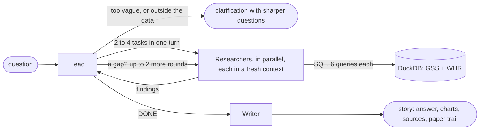

# the happiness desk

[](https://happiness-agent-git-667678606632.europe-west1.run.app/)
[](https://happiness-agent-git-667678606632.europe-west1.run.app/)
[](https://github.com/alex-is-busy-coding/happiness-agent/actions/workflows/checks.yml)

> **The live demo asks you to sign in with Google, and only columbia.edu accounts get in.**
> Every question spends a few dozen model calls, so the sign-in keeps strangers from running
> up the bill. Use your Columbia (LionMail) account when prompted.

*What makes a happy life?* A tiny data newsroom staffed by AI agents. Ask it a question about
happiness and a **Lead** splits it into tasks, fans out **Researchers** that query half a
century of survey data in parallel with SQL, goes back for more when the findings leave a gap,
and a **Writer** files a short story: the answer first, then charts, a source on every claim,
and what the data can't tell you. Every query the researchers ran is shown.

**Research question:** How do our daily habits, social connections and economic realities
combine to create both momentary happiness and lifelong meaning?

**Target user:** the curious non-specialist (students, journalists, anyone who has wondered
whether money, marriage or friends actually move the needle) who wants answers grounded in
named surveys, with the work shown.

## How it works



**Path:** Deep Research (`research`).

- **Three agent shapes with different jobs.** The Lead plans, delegates and judges coverage;
  it has no access to the data. Researchers answer one task each with `run_sql`. The Writer
  sees only the question and the findings.
- **Parallel fan-out in fresh contexts.** The Lead calls `research` once per task in a single
  turn; each call runs a new Researcher with its own context and its own budget of 6 queries.
- **Back for more, up to a cap.** The Lead reads the findings and may send further
  Researchers for a gap: at most 6 Researchers and 12 Lead turns in all, no new Researcher
  after 150 s, and research ends at 210 s so the Writer always has time inside five minutes.
- **Vague questions get a clarification**, with sharper questions to pick from. A reply in
  the same conversation ("the first one") is read as the answer to it.
- **Cited.** Every sentence that states a fact names its survey, every number must come from
  a query result, and each story carries its full paper trail of SQL and returned rows.

## The front end

The design borrows from data-journalism sites like [The Pudding](https://pudding.cool/): each
answer is a *story* with its own colour, a lowercase cover line, and a methods note.

- **An archive that opens instantly.** The front page is a shelf of stories the agent has
  already researched (`stories/`, built by `make_stories.py`), so a first-time visitor reads a
  finished piece in seconds before deciding to wait for one of their own.
- **A live research board.** While a run is in progress the page shows the stage (plan,
  research, gap check, write), the lead's plan, and one card per researcher with its task, the
  SQL it is running right now, and its query budget.
- **Guess the stat.** The wait comes with a guessing game: drag a slider, lock it in, see the
  real number. The answers are computed from the database by `prepare_data.py`.
- **Stories, not reports.** A pull-quote answer, three headline numbers, sections with one
  point each, charts titled with their takeaway, and source chips on every claim.
- **How we did this.** Every story ends with its paper trail: each researcher's task, every
  SQL query, and the rows that came back. For a story you just commissioned, "see how the
  agents think" opens the starter's context panel with the exact messages each agent saw.
- Stories you commission are kept in your browser and get their own shelf.

## The data

Prepared offline by `prepare_data.py` into `data/happiness.duckdb` (committed, so the deploy
ships with it):

| Table | Source | What it is |
|---|---|---|
| `gss` | [GSS 1972–2024 cumulative file, NORC](https://gss.norc.org/us/en/gss/get-the-data.html) (Stata, release 3a) | 75,699 US adults: self-reported happiness alongside social life, marriage, income, health, trust. Answer codes decoded to labels, person weights kept, family income converted to 2024 dollars. |
| `whr` | [World Happiness Report 2026, Data for Figure 2.1](https://worldhappiness.report/data-sharing/) | 2,116 country-years (168 countries, 2011–2025) of Gallup World Poll life evaluations, with the report's six-factor decomposition from 2019 on. |
| `atus_wb` | [ATUS Well-Being Module 2021, BLS](https://www.bls.gov/tus/data/wbdatafiles-2021.htm) | Not loaded yet: how happy, meaningful and stressful specific activities felt. BLS blocks scripted downloads, so its five zips must be fetched by hand (see below). Until then the agent says it can't answer questions about specific daily activities. |

The same script writes `data/context.md`, the schema notes injected into every agent's
instructions. They carry what a careful analyst would need to know: which way each answer
code runs, to weight every share, what each World Happiness Report factor does and does not
measure, and that the GSS moved from in-person interviews to the web in 2021, so a drop in
the 2020s may partly be a change in method. It also writes `data/guesses.json`.

The model knows the folklore of happiness research and some headline figures. It does not
know this microdata: weighted shares for any cross-tab of a 75,699-row file, or the 2026
edition's country scores, only come out of the queries.

To rebuild from scratch:

```sh
# 1. Put the raw files in data_raw/: gss7224_r3a.dta (from the GSS Stata zip),
#    WHR26_Data_Figure_2.1.xlsx, and optionally the five BLS zips wbact-2021, wbresp-2021,
#    atusact-2021, atussum-2021, atuswho-2021 (download those in a browser).
uv run --group prep prepare_data.py   # the database, context.md, guesses.json
uv run make_stories.py                # research the archive's stories with the live agent
```

## Run it

```sh
gcloud auth application-default login
cp .env.example .env   # set GOOGLE_CLOUD_PROJECT (a project with the Vertex AI API enabled)
uv run app.py          # open http://localhost:8000
```

### `/chat`

The Project 1 request and response, with the agent added to each tool call:

```sh
curl -s localhost:8000/chat -H 'Content-Type: application/json' \
  -d '{"message": "Are married people happier than single people?"}'
```

```jsonc
{
  "response": "# marriage & happiness\n\n*Does tying the knot ...",  // the story, or a clarification
  "session_id": "5f0c…",       // send it back to continue the conversation
  "tool_calls": [              // the Lead's and every Researcher's, in order
    {"agent": "Lead", "name": "research", "args": {"task": "…"}, "result": "…"},
    {"agent": "Researcher 1", "name": "run_sql", "args": {"sql": "SELECT …"}, "result": "| marital_label | … |"}
  ],
  "sources": [{"name": "General Social Survey 1972-2024 (NORC)", "url": "https://gss.norc.org/", "updated": "every two years"}]
}
```

A run takes one to four minutes, so set the client's timeout to five. The page itself uses
`GET /run?question=...`, the same run streamed as Server-Sent Events. `/stories`,
`/stories/{id}`, `/guesses` and `/meta` serve the archive, the guessing game and the dataset
counts in the masthead.

## Project layout

```
app.py              the HTTP surface: the page, the archive, /run (SSE) and /chat
desk/
  agents.py         the Lead, Researcher and Writer, their tools, and one run through them
  prompts.py        what each agent is told
  story.py          from the Writer's reply to a story; the run's tool calls and paper trail
  database.py       read-only queries against the DuckDB
  archive.py        featured stories and those filed since startup
  limits.py         the budget on runs
  config.py         paths, the model, and every limit in one place
index.html, static/ the page, its stylesheet and script
prepare_data.py     offline: raw survey files -> database, schema notes, guess cards
make_stories.py     offline: research the archive's stories with the live agent
baseline.py         the same model with no tools, for the comparisons below
evals/              42 scored questions, the runner, and the two recorded runs
tests/              unit tests for everything that doesn't need a model
context_panel.py, context-panel.js   the course starter's context panel, unchanged
```

```sh
uv run --group dev pytest        # 26 tests, no model calls
uv run --group dev ruff check .  # and `ruff format --check .`; both run in CI on every push
```

## Sample queries for grading

Each is also in the archive on the front page, so the expected story can be read without
waiting. Baselines are the same model with no tools and no system prompt (`uv run baseline.py`).

**1. "Are married people happier than single people?"**
Expected: yes. About 39% of married respondents say "very happy", against about 21% of the
never-married and about 15% of the separated (weighted, 1972–2024). From the `gss` table
(`happy`, `marital`, `weight`).

> *No tools:* a long essay on "the quality factor", selection effects and the honeymoon
> effect. Reasonable folklore, not one checkable number, and it concludes that the averages
> are "a misleading statistic".
>
> *Agent:* "Married Americans are consistently more likely to report being very happy, with
> 39% doing so compared to 21% of those who never marry ... only 15% of separated individuals
> report the same ... a marriage happiness gap of about 18 percentage points for both sexes",
> with the gap charted by decade and a note that the 2020s figures follow a change in how the
> survey was run.

**2. "Why do Nordic countries top the happiness rankings?"**
Expected: in 2025 the five Nordic countries hold five of the top six places (Finland first at
7.8 out of 10) and average 7.5 against 5.6 for the other 142 countries. In the report's factor
decomposition their largest relative edge is in not seeing corruption as widespread (0.40
points against a world average of 0.15). From the `whr` table (`life_evaluation`, `rank`,
`explained_by_*`, year 2025).

> *No tools:* an essay on the welfare state, *hygge* and *friluftsliv*. Plausible, uncited,
> and none of it checkable.
>
> *Agent:* "Five of the top six spots in the global happiness rankings belong to Nordic
> nations ... averaging an overall life evaluation of 7.5, compared to an average of 5.6 for
> the other 142 countries ... low corruption explaining 0.4 points in the Nordic region
> compared to 0.1 points elsewhere", plus each country's rank history since 2011.

**3. "How much does seeing friends matter for happiness?"**
Expected: less simply than you'd think. The share who are "very happy" peaks among people
who see friends several times a month (33%) and is the same for those who see friends almost
daily as for those who never do (27% each). From the `gss` table (`happy`, `socfrend`,
`weight`).

> *No tools:* "social connection is the single most important determinant of human
> happiness", citing the Harvard study and a claim that seeing friends almost every day is
> worth an extra $100,000 a year. More is always better.
>
> *Agent:* "Moderate socializing goes with the highest happiness, as 33% of those who see
> friends several times a month report being very happy compared to 27% of daily socializers
> ... exactly the same share as those who never socialize at all", and the share seeing
> friends at least weekly fell from 23% in the 1970s to 16% in the 2020s.

A fourth to try: **"tell me about happiness"** comes back as a clarification with three
sharper questions, and **"which daily activities feel most meaningful?"** comes back saying
the time-use data isn't loaded, with questions the other surveys can answer.

## Evals

Not required on the Deep Research path, but the most direct evidence that the agent answers
its questions correctly. `evals/samples.json` holds 42 samples, none of which appears in a
prompt (the prompts' two format examples are about tea, on purpose):

| Kind | n | Where each comes from | Passes when |
|---|---|---|---|
| answer | 30 | Gold computed by the sample's own SQL against the database (20 GSS, 10 WHR), so it moves with the data. `--gold` prints it. | the story states every gold number, within rounding, and names every gold country |
| clarify | 6 | Written by hand: too vague to turn into a data question | the Lead asks instead of guessing |
| decline | 6 | Written by hand: genes, pets, cities, therapy, a forecast, the unloaded time-use data | the Lead says the data can't answer, instead of filing a story |

Two kinds of scorer. **Deterministic checks:** the right kind of outcome; the gold answer in
the story; the expected survey cited; and traceability, which looks up every percentage or
decimal the story states in prose among the rows its researchers' queries returned. **A judge
with a rubric** (the same model, temperature 0): does any sentence claim causation from a
correlation?

```sh
uv run python -m evals.run          # all 42: about 20 minutes of model calls
uv run python -m evals.run --gold   # just print the gold answers
```

| | Baseline | After change 1 |
|---|---|---|
| **Passed** (n = 42, margin ±15 points) | **41 / 42** | **42 / 42** |
| answer: gold answer in the story | 30 / 30 | 30 / 30 |
| clarify: asked instead of guessing | 6 / 6 | 6 / 6 |
| decline: said the data can't answer | 5 / 6 | 6 / 6 |
| stories citing the expected survey | 30 / 30 | 30 / 30 |
| stated statistics found in a query result | 408 / 409 | 390 / 391 |
| stories with no causal claim, per the judge (n = 30, margin ±18 points) | 23 / 30 | 23 / 30 |
| seconds per story: median, slowest | 83, 249 | 83, 156 |

- **Baseline** (`evals/results/1-baseline.json`). The one miss: asked "How happy will
  Americans be in 2040?", the desk wrote a story about past trends. The judge flagged seven
  stories for lines like "the daily grind dictates your mood".
- **Change 1** (`2-causal-wording.json`): the Lead now treats a forecast as outside the data,
  and the Writer got a longer list of banned causal words. The forecast is now declined. The
  judge's score did not move: the Writer reached for other verbs, mostly in headings ("trust
  buffers a lower income"). A list of words was the wrong tool; a rule about what a heading
  may claim is the next thing to try.
- **Neither difference is bigger than the margin of error** (±1/√n). One sample out of 42 is
  noise, and so is 23 against 23. What the numbers do support: the gold answer was in all 60
  stories across both runs, and nearly every stated statistic traces to a query result.

Two cautions about the scorers. The gold check looks for the number anywhere in the story, so
a coincidence could pass it. And the judge is the same model that wrote the story, with a
strict rubric: it flags the World Happiness Report's own "contribution" language too.

## What the data can't answer

The agent is told to say so, and the data really can't: anything causal (these are
cross-sectional correlations), anything about one person over time (the GSS interviews
different people each wave), how much of the 2020s drop in US happiness is real and how much
is the survey moving online, inequality inside a country in the World Happiness Report's
national averages, and anything needing medical, genetic or non-survey evidence. Researchers
flag these as `LIMIT:` bullets and the Writer closes the story with "what this data can't
tell you".

## Deploy

Continuous deploy from GitHub to Cloud Run using the included `Dockerfile` (listens on
`$PORT`). The database and the archive ship in the image; no GCS needed.

- **Access.** The service sits behind Identity-Aware Proxy, restricted to columbia.edu
  accounts.
- **Spend.** The app also caps itself: at most 4 runs at once and 200 a day per instance
  (`MAX_CONCURRENT_RUNS`, `MAX_RUNS_PER_DAY`). Past that, the page and `/chat` (with a 429) say
  the desk is full.
- **Time.** A run is built to finish inside five minutes. Set the Cloud Run request timeout
  to 600 s anyway, and keep to one instance: the context panel and follow-up conversations
  are held in memory.
